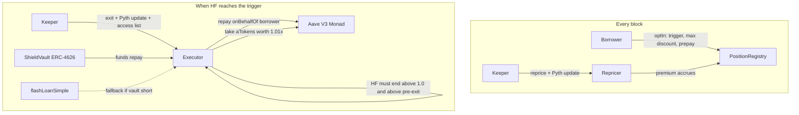

# Shield

Opt-in early exit for borrowers on Aave V3 Monad. Set a trigger a little above the liquidation line. When your position reaches it, a vault repays part of your debt and takes collateral at a 1% discount instead of Aave's 5.5% liquidation bonus on WETH. The price of that protection is recomputed every 300 ms block.

Built for Track 01 (Onchain Finance and Trading) of [Monad Metropolis](https://www.monad.xyz/developers/hackathons/metropolis). Submission closes 13 Oct 2026, 11:59pm ET.

## What it is, what it is not

Borrowers with large or illiquid collateral cannot deleverage by swapping without paying more than 1% in slippage. On Aave V3 Monad that is bridged WETH and cbBTC borrowed against stablecoins: on 5 Oct 2026, selling 1 WETH on Uniswap V3 Monad quoted 3.8% under the oracle price. Today these borrowers hold extra buffer, set alerts, or eat Aave's liquidation bonus (5.5% on WETH, 7% on cbBTC). Shield gives them a priced, opt-in exit at 1%.

Shield does not race liquidators. Aave on Monad runs Chainlink SVR via Atlas: the price update that pushes a position under water arrives in the same bundle as the winning liquidator's transaction. Shield triggers above health factor 1.0. That is the only honest design, and it is why the trigger is the borrower's choice.

Anyone may call `exit` when the condition holds. The keeper is a convenience, not a trust assumption.

## Why Monad

- 300 ms blocks make per-block premium repricing meaningful. On a 12-second chain the premium would be repriced 40 times less often and the keeper would act minutes late.
- MIP-8 page-ified storage: each borrower record is packed into one storage page, so after the first `SLOAD` every further slot of that record is cheap. The keeper's transaction carries an EIP-2930 access list that warms the whole page in one entry.
- The keeper reads health factors on the `pending` (proposed) tag and submits with `eth_sendRawTransactionSync`, which returns the receipt on the proposed block; finality follows in 600 ms.
- Gas is charged as gas_limit x price on Monad, so every keeper call uses a measured limit and the Executor's gas is published below.

## How it works



Premium per block: `p = k * sigma * V / max(d, d_min) * dt`, where V is the debt covered, sigma is realised collateral volatility from Pyth over the last N blocks, d is the distance between current HF and the trigger, d_min bounds the premium, and dt is one block. The borrower prepays a balance; when it runs out, cover lapses and the UI shows "unprotected".

### Pricing parameters

| Parameter | Value | Meaning |
| --- | --- | --- |
| `k` (WETH) | 0.00125 | Calibrated so a position at distance d = 0.05 with 80% annualised volatility pays 2% of covered debt a year: 0.02 = k x 0.80 / 0.05 |
| `k` (cbBTC) | 0.00125 | Same calibration. The formula already carries each asset's own volatility, so the same target gives the same k |
| `d_min` | 0.01 | Floor on the HF distance; caps the premium at 5x the d = 0.05 rate |
| `N` | 200 | Pyth observations in the realised-volatility window |
| sigma fallback | 80% | Used until a feed has 10 observations; realised sigma is clamped to [10%, 500%] |
| Default trigger | 1.04 | Borrower's choice, between 1.01 and 2.00 |
| Exit discount | 1% | Borrower's max discount must be at least this (default 1%, at most 5%) |
| Exit target | trigger + 0.06 | The exit repays enough debt to bring HF back to this |

The calibration is a Foundry test: `test_calibration_kGivesTwoPercentAtD5Sigma80` in [contracts/test/unit/PremiumMath.t.sol](contracts/test/unit/PremiumMath.t.sol).

Full design: [docs/SPEC.md](docs/SPEC.md). Stack and reasoning: [docs/TECH-DECISIONS.md](docs/TECH-DECISIONS.md).

## Contracts

| Contract | Responsibility |
| --- | --- |
| `PositionRegistry` | One packed record per opted-in borrower, page-aligned for MIP-8 |
| `Repricer` | Per-block premium from Pyth price, realised volatility and distance to trigger; accrues against the prepaid balance |
| `Executor` | The exit: vault funds or flash loan, `Pool.repay` on behalf of the borrower, `aToken.transferFrom` at 1.01x, reverts unless HF improves and stays above 1.0 |
| `ShieldVault` | ERC-4626 vault; LPs fund exits and earn premiums plus the 1% discount |

## Compared with what exists

| | Shield | Morpho pre-liquidation | Euler V2 native | DeFi Saver automation |
| --- | --- | --- | --- | --- |
| Lender covered | Aave V3 Monad | Morpho Blue only | Euler vaults only | Aave, Morpho, others |
| On Monad today | Yes | Yes, Morpho Blue markets only | Yes | No (6 chains, not Monad) |
| Mechanism | Opt-in early trigger, vault repays, 1% discount | Opt-in preLIF and preLltv, permissionless caller | Reverse Dutch auction from 0% discount | Repay from collateral via swap |
| Cost to borrower | Premium per block plus 1% on seized collateral | preLIF discount | Rising discount | About 0.08% plus swap slippage |
| Who funds the exit | Vault LPs, flash-loan fallback | Any liquidator | Any liquidator | Borrower's own collateral |
| Wins when | Collateral is illiquid or large; swap slippage exceeds 1% | Borrower is on Morpho | Borrower is on Euler | Collateral is liquid |

## Repository layout

| Path | What |
| --- | --- |
| `contracts/` | Foundry project: the four contracts, tests, deploy scripts |
| `keeper/` | TypeScript keeper on viem |
| `web/` | Next.js app: borrower opt-in, LP dashboard |
| `indexer/` | Envio HyperIndex for positions, repricing and exits |
| `docs/` | Build spec, technical decisions, progress log |
| `scripts/` | Deployment, demo setup, repricing capture |
| `CLAUDE.md` | Guide for coding agents working in this repo |

## Status

| Milestone | State |
| --- | --- |
| M0 Verify external facts | done |
| M1 Scaffold contracts, keeper, web, indexer | done |
| M2 Contracts and Foundry tests | done |
| M3 Keeper | not started |
| M4 Web | not started |
| M5 Envio indexer | not started |
| M6 Mainnet deployment and proof | not started |
| M7 Submission | not started |

## Deployments (Monad mainnet, chain id 143)

| Contract | Address |
| --- | --- |
| PositionRegistry | pending M6 |
| Repricer | pending M6 |
| Executor | pending M6 |
| ShieldVault | pending M6 |

## Proof

Filled during M6. Every item opens on [monadvision.com](https://monadvision.com) or [monadscan.com](https://monadscan.com).

| Item | Value |
| --- | --- |
| Opt-in tx | pending M6 |
| Three consecutive repricing txs | pending M6 |
| Exit tx (`Exited` event) | pending M6 |
| Executor gas (forge snapshot, Monad execution, cold state) | `exit` funded by the vault: 1,109,278; `exit` through the flash-loan fallback: 1,714,904; `reprice` (one borrower): 618,956; `repriceMany` (three borrowers): 827,870. Source: [contracts/snapshots/](contracts/snapshots/) and [contracts/.gas-snapshot](contracts/.gas-snapshot) |
| Envio indexer endpoint | pending M5 |
| Demo video | pending M6 |

## Quick start

Requirements: git, [Foundry](https://getfoundry.sh) 1.8 or later (Monad execution), Node 22 or later, pnpm 11.

```bash
git clone --recurse-submodules https://github.com/pratikasr/shield.git
cd shield

# contracts
cd contracts && forge build && forge test && cd ..

# keeper, web, indexer
pnpm install
pnpm -r build
```

If you cloned without `--recurse-submodules`, run `git submodule update --init` first.

## Bounties

Envio: positions, repricing and exits are indexed with Envio HyperIndex (`indexer/`) and served to the web app from Envio's hosted endpoint.

## Disclosures

- Pre-existing code: none. Everything in this repository was written for this hackathon. OpenZeppelin Contracts, Aave V3 interfaces and the Pyth Solidity SDK are dependencies.
- AI tools: Claude (Anthropic) via Claude Code and Cowork, used for research, specification and code generation.

## License

MIT. See [LICENSE](LICENSE).
