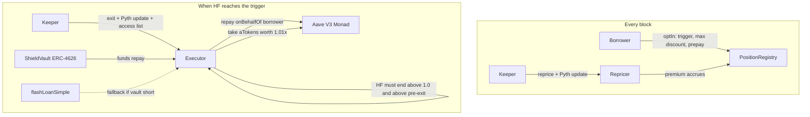

# Shield

Opt-in early exit for borrowers on Aave V3 Monad. Set a trigger a little above the liquidation line. When your position reaches it, a vault repays part of your debt and takes collateral at a 1% discount, plus a per-block premium while you are covered, instead of Aave's 5.5% liquidation bonus on WETH. The premium is recomputed every 300 ms block.

Built for Track 01 (Onchain Finance & Trading) of [Monad Metropolis](https://www.monad.xyz/developers/hackathons/metropolis). Submission closes 13 Oct 2026, 11:59pm ET.

## What it is, what it is not

Swapping collateral to deleverage is cheap on Monad for most sizes: on 5 Oct 2026 an aggregator quoted 0.06% under Aave's oracle for 1 WETH and 0.49% for 50 WETH. What a borrower cannot buy today is an exit that happens on its own, on chain, at a health factor they choose, without watching the market. Today they hold extra buffer, set alerts, or eat Aave's liquidation bonus (5.5% on WETH). Shield gives WETH borrowers with USDC debt an opt-in exit, enforced by the contracts, at a known 1% plus a per-block premium. It matters most for large positions and for the moments when liquidity thins. cbBTC is listed but disabled until a cbBTC/USDC swap route exists on Monad (ADR-034).

Shield does not race liquidators. Aave on Monad runs Chainlink SVR via Atlas: the price update that pushes a position under water arrives in the same bundle as the winning liquidator's transaction. Shield triggers above health factor 1.0. That is the only honest design, and it is why the trigger is the borrower's choice.

Anyone may call `exit` when the condition holds. The keeper is a convenience, not a trust assumption.

## Why Monad

- 300 ms blocks make per-block premium repricing meaningful. On a 12-second chain the premium would be repriced 40 times less often and an exit could wait up to 12 seconds for the next block.
- MIP-8 page-ified storage: each borrower record is packed into one 128-slot storage page, and each collateral's 200-observation volatility window into another, so after the first access every further slot costs 100 gas. Every keeper transaction carries an EIP-2930 access list naming the pages it will touch, Aave's and Shield's, with one key per page. Measured on a mainnet fork: `repriceMany` 523,194 gas without the list, 192,094 with it (63% less); `exit` 1,203,849 without, 682,349 with (43% less). Most of the saving is Aave's and the tokens' pages; Shield's own layout keeps its share to one page per record and one per feed.
- The keeper reads health factors on the proposed block (`latest`, the same as `pending` on Monad) and submits with `eth_sendRawTransactionSync`, which returns the receipt from the proposed block; finality follows in 600 ms. On a local fork the receipt came back in about 290 ms; the mainnet figure will be published with the proof.
- Gas is charged as gas_limit x price on Monad, so every keeper call uses a measured limit and the Executor's gas is published below.

## How it works



Premium per block: `p = k * sigma * V / max(d, d_min) * dt`, where V is the borrower's total Aave debt in USD (not the smaller amount an exit repays), sigma is realised collateral volatility from the last 200 Pyth observations, d is the distance between current HF and the trigger (at or below the trigger d is taken as d_min, the most expensive rate), d_min bounds the premium, and dt is one block. Each interval is billed at the higher of the stored and the live rate. The borrower prepays at least 1 USDC; when it runs out, cover lapses and the UI shows "unprotected". New, restored or raised cover can exit only after a 15-minute waiting period (ADR-031).

### Who earns what

At launch the vault is protocol-funded: the treasury is its only depositor, so all of Shield's income goes to the protocol (ADR-039).

| Income | Where it goes |
| --- | --- |
| Premiums, charged every block | 10% straight to the treasury (`sweepProtocol`; the owner can set 0% to 20%, capped in the contract, ADR-037); 90% to the vault |
| Exit discount, 1% of the debt an exit repays | 100% to the vault, which holds the seized collateral until it is sold |
| The vault's income | To its only shareholder, the protocol treasury, through the share price |

The borrower's cost is the same either way: the protocol's part comes out of the premium, never on top of it. Premium income accrues every block while covers are active; exit income depends on volatility and on when exits happen, and between an exit and the unwind the vault carries the seized collateral's price. Outside liquidity providers are on the roadmap: the vault stays ERC-4626 with a depositor allowlist, so they can be added without a redeploy, and then 90% of income would go to them and 10% to the protocol. Earnings by hour, day and since deployment come from the Envio indexer and appear on the app's Analytics page.

### Premium from any chain

Every borrower has a deposit address on Monad: `ShieldForwarderFactory.forwarderFor(borrower)`, a CREATE2 address known before anything is deployed there. USDC sent to it, from another chain through Aurora Intents or by a plain transfer on Monad, becomes that borrower's prepaid premium when anyone calls `sweepPremium(borrower)`; the keeper does it automatically. The treasury funds the vault the same way through `treasuryForwarder()` and `sweepVault()`. The borrower never needs MON or a network switch to keep cover funded. A refund from Aurora goes back to the sender on the origin chain.

### Pricing parameters

| Parameter | Value | Meaning |
| --- | --- | --- |
| `k` (WETH) | 0.00125 | Calibrated so a position at distance d = 0.05 with 80% annualised volatility pays 2% of covered debt a year: 0.02 = k x 0.80 / 0.05 |
| `k` (cbBTC) | 0.00125 | Same calibration (cbBTC is configured but disabled at launch, ADR-034). The owner can set k up to 0.0125 |
| `d_min` | 0.01 | Floor on the HF distance; caps the premium at 5x the d = 0.05 rate |
| `N` | 200 | Pyth observations in the realised-volatility window |
| sigma fallback | 80% | Used until a feed has 10 observations; realised sigma is clamped to [10%, 500%] |
| Default trigger | 1.04 | Borrower's choice; the contract accepts 1.01 to 2.00 |
| Waiting period | 15 minutes | Time cover must be held before it can exit (owner-set, at most 7 days) |
| Minimum prepay | 1 USDC | Needed to opt in |
| Exit discount | 1% | Borrower's max discount must be at least this (default 1%, at most 5%) |
| Exit target | trigger + 0.06 | The exit repays enough debt to bring HF back to this |
| Protocol share | 10% of premiums | Paid to the treasury by `sweepProtocol()`, which anyone may call; at most 20% (`MAX_PROTOCOL_SHARE_BPS`) |

The calibration is a Foundry test: `test_calibration_kGivesTwoPercentAtD5Sigma80` in [contracts/test/unit/PremiumMath.t.sol](contracts/test/unit/PremiumMath.t.sol).

Full design: [docs/SPEC.md](docs/SPEC.md). Stack and reasoning: [docs/TECH-DECISIONS.md](docs/TECH-DECISIONS.md).

## Contracts

| Contract | Responsibility |
| --- | --- |
| `PositionRegistry` | One packed record per opted-in borrower, page-aligned for MIP-8 |
| `Repricer` | Per-block premium from Pyth price, realised volatility and distance to trigger; accrues against the prepaid balance |
| `Executor` | The exit: vault funds or flash loan, `Pool.repay` on behalf of the borrower, `aToken.transferFrom` at 1.01x, reverts unless HF improves and stays above 1.0, and (on the flash path) unless the vault gets back at least what it paid |
| `ShieldVault` | ERC-4626 vault in USDC; LPs fund exits and earn premiums plus the 1% discount. NAV is USDC, seized aTokens at Aave's oracle, and premium accrued at the Repricer, less exit gains still unlocking (they reach the share price over six hours) |
| `UniswapV3Swapper` | Helper: the bounded swap the flash-loan fallback and vault unwinds use (Uniswap V3 on Monad) |

The exit is permissionless: anyone may call `Executor.exit` when the conditions hold, and the contract checks every one of them. The keeper is a convenience, not a trust assumption. Trust model and static-analysis results: [docs/SECURITY.md](docs/SECURITY.md).

## Compared with what exists

| | Shield | Morpho pre-liquidation | Euler V2 native | DeFi Saver automation |
| --- | --- | --- | --- | --- |
| Lender covered | Aave V3 Monad | Morpho Blue only | Euler vaults only | Aave, Morpho, others |
| On Monad today | Yes | Yes, Morpho Blue markets only | Yes | No (6 chains, not Monad) |
| Mechanism | Opt-in early trigger, vault repays, 1% discount | Opt-in preLIF and preLltv, permissionless caller | Liquidation discount that starts at 0% and rises as health worsens | Repay from collateral via swap |
| Cost to borrower | Premium per block plus 1% of the debt repaid | preLIF discount | A discount that rises as health worsens | About 0.3% per automated repay (0.25% service fee plus 0.05% automation fee), plus gas and slippage |
| Who funds the exit | Vault LPs, with a small flash-loan fallback | Any liquidator | Any liquidator | Borrower's own collateral |
| Wins when | You want an on-chain exit at a set health factor on Aave Monad, for large positions or thin moments | Borrower is on Morpho | Borrower is on Euler | Collateral is cheap to swap, on chains it supports |

## Repository layout

| Path | What |
| --- | --- |
| `contracts/` | Foundry project: contracts, unit, fork, fuzz and invariant tests, deploy and demo scripts |
| `keeper/` | TypeScript keeper on viem |
| `web/` | Next.js app: landing, borrower page, LP page; Playwright end-to-end and review specs |
| `indexer/` | Envio HyperIndex for positions, repricing, exits and vault flows |
| `docs/` | Spec, technical decisions, design, security, test report, demo runbook, progress log |
| `scripts/` | Mainnet deploy, demo position, indexer deploy, local fork stack, end-to-end run |
| `CLAUDE.md` | Guide for coding agents working in this repo |

## Status

| Milestone | State |
| --- | --- |
| M0 Verify external facts | done |
| M1 Scaffold contracts, keeper, web, indexer | done |
| M2 Contracts and Foundry tests | done |
| M3 Keeper | done: on Monad testnet the keeper repriced and exited a real position on an Aave V3 market deployed from Aave's code (ADR-040, below); also on a mainnet fork |
| M4 Web | done, rehearsed end to end on a mainnet fork |
| M5 Envio indexer | done locally; the hosted deployment needs the owner's Envio login (`scripts/deploy-indexer.sh`) |
| M6 Mainnet deployment and proof | scripted and rehearsed; waiting for mainnet funds and keys |
| M7 Submission | waiting for M6 and the video |

## Deployments (Monad mainnet, chain id 143)

Not deployed yet. `bash scripts/deploy-mainnet.sh` deploys and writes `contracts/deployments/143.json` once every address holds code (it refuses to run again while that file exists, unless `--force`); `bash scripts/verify-mainnet.sh` verifies on MonadVision (and Monadscan with `ETHERSCAN_API_KEY`) and can be rerun on its own. The addresses go here.

| Contract | Address |
| --- | --- |
| PositionRegistry | not deployed yet (M6) |
| Repricer | not deployed yet (M6) |
| Executor | not deployed yet (M6) |
| ShieldVault | not deployed yet (M6) |
| UniswapV3Swapper | not deployed yet (M6) |

## Proof

Filled during M6 with Monad mainnet transactions only, from `bash scripts/proof.sh`, which checks every address and receipt on chain first; every item will open on [monadvision.com](https://monadvision.com) or [monadscan.com](https://monadscan.com). The fork rehearsals in [docs/DEMO.md](docs/DEMO.md) are tests, not proof.

| Item | Value |
| --- | --- |
| Opt-in tx | not yet (M6) |
| Three consecutive repricing txs | not yet (M6) |
| Exit tx (`Exited` event) | not yet (M6) |
| Protocol share paid to the treasury (`ProtocolPremiumPaid`) | not yet (M6) |
| Gas (forge snapshot at block 113,031,739, Monad execution, cold state) | `exit` funded by the vault 1,178,122; `exit` through the flash-loan fallback 1,852,575; `reprice` of one borrower 526,248; `repriceMany` of three 704,199; vault `unwind` 831,017. The protocol share added about 2,100 gas to a reprice (0.4%) and 2,400 to an exit. Source: [contracts/snapshots/](contracts/snapshots/), [contracts/.gas-snapshot](contracts/.gas-snapshot) |
| Gas with the keeper's access list (mainnet fork, measured before the audit fixes with `pnpm --filter keeper measure`) | steady-state `repriceMany` for one borrower 192,094 (523,194 without); `exit` 682,349 (1,203,849 without) |
| Envio indexer endpoint | not yet (needs the owner's Envio login) |
| Demo video | not yet (M6) |

## Staging run on Monad testnet (chain id 10143)

Aave V3 is not deployed on Monad testnet, so for this run we deployed a full Aave V3 market there ourselves from Aave's own code ([aave-v3-origin](https://github.com/aave-dao/aave-v3-origin) v3.7, its batched deployment), with two mintable test tokens named WETH and USDC, priced by Pyth's testnet contract and listed with Aave Monad's mainnet parameters (WETH 80.5% LTV, 84% liquidation threshold, 5.5% bonus). The market, the tokens and their admin are ours ([ADR-040](docs/TECH-DECISIONS.md)). Shield's contracts are the same code as on mainnet. This is a staging run on a live Monad network, not the mainnet proof above.

| Item | Value |
| --- | --- |
| Aave V3 Pool (ours, Aave's code) | [`0x123BceeC0B4f6799EC40da83467aeDb07716D83D`](https://testnet.monadvision.com/address/0x123BceeC0B4f6799EC40da83467aeDb07716D83D) |
| Test WETH, test USDC | [`0x6092562e8898B959228f4277FBa2bDdfe76FA782`](https://testnet.monadvision.com/address/0x6092562e8898B959228f4277FBa2bDdfe76FA782), [`0x2c0C140b3c98CA12BaC20045d8C791ecF75002dA`](https://testnet.monadvision.com/address/0x2c0C140b3c98CA12BaC20045d8C791ecF75002dA) |
| PositionRegistry | [`0x8B4bbd772Cc6f2DC4BeF803aca313E7A5D7DA87a`](https://testnet.monadvision.com/address/0x8B4bbd772Cc6f2DC4BeF803aca313E7A5D7DA87a) |
| Repricer | [`0x266D8bEE03E2458C569566D181558b085b0F0e66`](https://testnet.monadvision.com/address/0x266D8bEE03E2458C569566D181558b085b0F0e66) |
| Executor | [`0x68F8ad1c7AED579FCE8Fe28Af68747173D41b554`](https://testnet.monadvision.com/address/0x68F8ad1c7AED579FCE8Fe28Af68747173D41b554) |
| ShieldVault | [`0x7F4A17f4b780Cc597BeCFb7773Aa60943ceBE485`](https://testnet.monadvision.com/address/0x7F4A17f4b780Cc597BeCFb7773Aa60943ceBE485) |
| ShieldForwarderFactory | [`0x5FA29aC7D3e406A2a1dF5354478640314B83B9e4`](https://testnet.monadvision.com/address/0x5FA29aC7D3e406A2a1dF5354478640314B83B9e4) |
| Opt-in (1 WETH supplied, $1,972.84 borrowed, health factor 1.07, trigger 1.06) | [`0x6fd50129...9880`](https://testnet.monadvision.com/tx/0x6fd501291785723e6f4b713362c483ec2d5f6d8ba39aef885dfbdbe90f619880) |
| Reprices from the keeper (blocks 70,734,521, 526 and 530; ten in all) | [`0x1e54e97f...7d95`](https://testnet.monadvision.com/tx/0x1e54e97fb37976f3487d1884d982af022e7512db42e85e53dc4e323af09f7d95), [`0x7f07c147...e006`](https://testnet.monadvision.com/tx/0x7f07c1476a089959dfc9f0c87023787140717e626389f0939fc5a2be810de006), [`0x0b3d6f7d...afc7`](https://testnet.monadvision.com/tx/0x0b3d6f7d8a784b489d1b73e841a6b334643a73c88a2df782a038cb877e04afc7) |
| The borrower borrows more, health factor 1.05 | [`0x9f185df2...5f94`](https://testnet.monadvision.com/tx/0x9f185df2114834cba740a136a04054cdc14f1696e0f21af9e590ee6a17c85f94) (block 70,734,821) |
| Exit (`Exited`: repaid 518.22 USDC, took 0.2082 WETH, health factor 1.05 to 1.12, $23.32 less than Aave's bonus, no flash loan) | [`0xb420db74...42ee`](https://testnet.monadvision.com/tx/0xb420db749132b14f55562070971fedbabdbcd3d6b7bdb53e5a18767d465242ee) (block 70,734,827, 761,236 gas) |

The same flow through the web app, signed by a test wallet in the browser: Shield turned on with the Early line (health factor 1.08) in four wallet transactions, armed after 60 s, the borrower borrowed down to 1.05 with the testnet Test loan card, and the keeper stepped in 3 s later ([`0xf7eb9429...090e`](https://testnet.monadvision.com/tx/0xf7eb94292f221dcbaf150a4055be42e4f5fb10bc6480bbf12f22e9511c03090e), block 70,747,526); the page showed $27.82 avoided.

From this machine the keeper's `eth_sendRawTransactionSync` receipts took 0.49 to 0.79 s (median 0.65 s), longer than a 300 ms block, so its reprices landed every three to five blocks rather than every block. The commands are in [docs/DEMO.md](docs/DEMO.md), Staging on Monad testnet.

The hosted app, https://shieldexit.xyz, runs on this testnet market until the mainnet deployment and says so on every page; the read-only view of the rescued borrower is [/app/borrow?address=0x2F50...962d](https://shieldexit.xyz/app/borrow?address=0x2F5068762ee626Ae91f3745cED7F021e2710962d).

## Quick start

Requirements: git, [Foundry](https://getfoundry.sh) 1.8 or later (`foundryup`; earlier versions have no Monad execution), Node 22 or later, pnpm 11, and Docker for the local indexer.

```bash
git clone --recurse-submodules https://github.com/pratikasr/shield.git
cd shield

# contracts: unit tests run offline; set MONAD_RPC_URL to also run the fork tests against real Aave on Monad
cd contracts
forge build
forge test
MONAD_RPC_URL=https://rpc.monad.xyz forge test
cd ..

# keeper, web, indexer
pnpm install
pnpm -r build
pnpm lint
pnpm test
```

If you cloned without `--recurse-submodules`, run `git submodule update --init` first.

The first fork-test run takes about 12 minutes, because every state read goes to the public RPC. Foundry caches that state per pinned block, so pin one with `FORK_BLOCK=<block>` (rpc.monad.xyz served state 500,000 blocks back on 5 Oct 2026, about 40 hours): a rerun at the same block took 4.4 minutes on 5 Oct 2026. Test runs do not rewrite the committed gas figures; `FORGE_SNAPSHOT_EMIT=true MONAD_RPC_URL=https://rpc.monad.xyz FORK_BLOCK=113031739 forge snapshot` refreshes them at the block they were measured at, for as long as Foundry's cache or an archive RPC holds it. A pinned block falls out of the public RPC's state window after about 500,000 blocks; then pin a recent one.

### Run the whole thing locally

Everything against a local fork of Monad mainnet (a test environment; the header says "Local fork"):

```bash
bash scripts/stack.sh up      # fork, Shield deployment, LP deposit, a borrower position, Envio, keeper, web
```

Open http://localhost:3200, choose "Fork test wallet" in Connect, set a trigger, approve, prepay and opt in. The keeper reprices every block. `bash scripts/stack.sh down` stops everything. `bash scripts/e2e.sh` runs the same flow under Playwright and checks the video script's key claims against the fork's receipts.

### On Monad mainnet

Keys stay in Foundry keystores and, for the keeper, in a `chmod 600` key file outside the repo; none goes on a command line or in the shell's environment (docs/DEMO.md shows how to create them).

```bash
export MONAD_RPC_URL=https://rpc.monad.xyz MONAD_WS_URL=wss://rpc.monad.xyz
export DEPLOYER_ACCOUNT=shield-deployer DEMO_ACCOUNT=shield-borrower LP_ACCOUNT=shield-lp
export KEEPER_PRIVATE_KEY_FILE=~/.shield/keeper.key KEEPER_ADDRESS=$(cat ~/.shield/keeper.address)
bash scripts/deploy-mainnet.sh            # refuses local RPCs, any chain but 143, and an existing 143.json
bash scripts/verify-mainnet.sh            # sends nothing; rerun until every contract is verified
bash scripts/demo-position.sh seed
bash scripts/demo-position.sh open
bash scripts/demo-position.sh keeper
bash scripts/demo-position.sh nudge       # after the 15-minute waiting period; checks the cover first
bash scripts/web-env.sh && pnpm --filter web build && pnpm --filter web start
bash scripts/proof.sh                     # Deployments and Proof rows, each checked on chain
```

The full runbook, account funding, the video steps and the fork rehearsals are in [docs/DEMO.md](docs/DEMO.md).

## Tests

| What | Command | Result |
| --- | --- | --- |
| Contracts: unit, fork, fuzz, invariant | `cd contracts && MONAD_RPC_URL=https://rpc.monad.xyz forge test` | 143 tests pass: 100 unit, fuzz and invariant (mocks), 43 fork tests against real Aave on Monad |
| Static analysis | Slither 0.11.6, Aderyn 0.6.8 | every high and medium fixed or justified in [docs/SECURITY.md](docs/SECURITY.md) |
| Keeper | `pnpm --filter keeper test` | 91 tests pass; 2 live smoke tests run with `LIVE_SMOKE=1` |
| Indexer | `pnpm --filter shield-indexer test` | 8 tests pass |
| Web: amounts, formatting, line and fuel presets, block stamps, analytics, Aurora requests and statuses | `pnpm --filter web test` | 64 tests pass |
| End to end, the video script on a fork | `bash scripts/e2e.sh` | passes |
| Demo rehearsal | two clean-fork runs of `scripts/e2e.sh` and one run of the scripted mainnet flow | pass; blocks and hashes in [docs/DEMO.md](docs/DEMO.md) |
| Lighthouse (mobile, devtools throttling) | landing, Protect, Vault, Stats | performance 97, 92, 99, 99; accessibility and best practices 100 on all; CLS 0.008 or less |

Dates, commands and outcomes for every round: [docs/TEST-REPORT.md](docs/TEST-REPORT.md). The internal audit of 5 Oct 2026 (contracts, keeper, indexer, scripts, web, live QA and every claim in these docs), its findings and their fixes: [docs/AUDIT.md](docs/AUDIT.md). Shield has had no external audit.

## Bounties

Aurora Intents: borrowers top up their premium, and the treasury funds the vault, from any chain Aurora supports. Aurora delivers USDC to a per-account deposit address on Monad, and Shield's forwarder executes on arrival: `sweepPremium` turns it into the borrower's prepaid premium, `sweepVault` into vault shares for the treasury (ADR-039).

Envio: every user-facing Shield event (opt-ins, triggers, each per-block reprice, exits, vault deposits, withdrawals, share transfers, premiums and collateral flows) is indexed with Envio HyperIndex (`indexer/`). The web app's exit history, repricing history, covered-positions table, vault activity and the LP premium rate read from its GraphQL endpoint. HyperSync serves Monad mainnet; the same indexer runs against the local fork over RPC.

## Disclosures

- Pre-existing code: none. Everything in this repository was written for this hackathon. OpenZeppelin Contracts, Aave V3 interfaces and the Pyth Solidity SDK are dependencies.
- AI tools: Claude (Anthropic) via Claude Code and Cowork, used for research, specification, code generation, testing and documentation.

## License

MIT. See [LICENSE](LICENSE).
