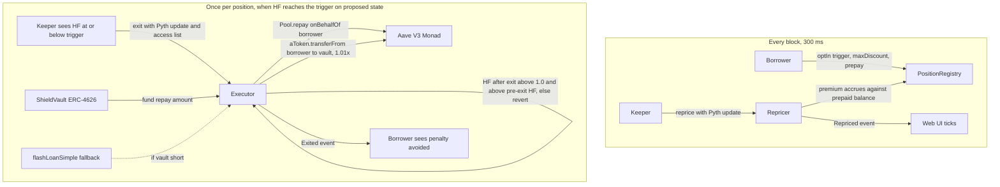

# Shield Build Spec

Author: Pratik Kumar. Written 4 Oct 2026, moved into the repo 5 Oct 2026.

Shield targets Track 01 (Onchain Finance and Trading) of Monad Metropolis, due 14 Oct 2026, 09:29 IST (13 Oct, 11:59pm ET). Red team verdict: GO WITH CHANGES, all applied below.

## Overview

Shield is an opt-in early exit for borrowers on Aave V3 Monad: the borrower sets a trigger a little above the liquidation line, and when the position reaches it a vault repays part of the debt and takes collateral at a 1% discount instead of the protocol's 5.5% penalty on WETH, with the price of that protection recomputed every 300 ms block.

**User.** Borrowers on Aave V3 Monad with WETH collateral and USDC debt who want an exit that happens on its own, on chain, at a health factor they choose, without watching the market. (Updated in the 5 Oct 2026 audit: an aggregator quoted 0.06% under the oracle for 1 WETH and 0.49% for 50 WETH, so swapping is not expensive for most sizes; the 3.8% figure was one thin Uniswap V3 pool. Shield matters most for large positions and when liquidity thins. cbBTC is disabled until a swap route exists, ADR-034. Aave Monad has no MON reserve, and its LST and PT collateral only works inside eModes, which Shield does not cover; see ADR-016 and ADR-035.) Today they hold extra buffer, set alerts, or eat the penalty.

**What it is not.** It does not race liquidators. Aave on Monad runs Chainlink SVR via Atlas: the price update that pushes a position under water arrives in the same bundle as the winning liquidator's transaction. Shield triggers above 1.0, which is the only honest design, and the README says so before a judge does.

**Why it can win.** Aave V3 arrived on Monad in July with $324M TVL and has no opt-in pre-liquidation layer. Morpho's pre-liquidation is live on Monad but covers Morpho Blue markets only. Euler has one built in; Aave does not. The one real "why Monad" is per-block premium repricing: pointless on a 12-second chain, nearly free here with MIP-8 page-warmed storage. That is the technical centerpiece and the video.

**Comparison the judges will build themselves, so build it first.**

| | Shield | Morpho pre-liquidation | Euler V2 native | DeFi Saver automation |
| --- | --- | --- | --- | --- |
| Lender covered | Aave V3 Monad | Morpho Blue only | Euler vaults only | Aave, Morpho, others |
| On Monad today | Yes | Yes, but Morpho Blue markets only (PreLiquidationFactory live since launch) | Yes | No (6 chains, not Monad) |
| Mechanism | Opt-in early trigger, vault repays, 1% discount | Opt-in preLIF and preLltv, permissionless caller | Reverse Dutch auction from 0% discount | Repay from collateral via swap |
| Cost to borrower | Premium per block plus 1% on seized collateral | preLIF discount | Rising discount | About 0.08% plus swap slippage |
| Who funds the exit | Vault LPs, flash-loan fallback | Any liquidator | Any liquidator | Borrower's own collateral |
| Wins when | Collateral is illiquid or large; swap slippage exceeds 1% | Borrower is on Morpho | Borrower is on Euler | Collateral is liquid |
| Status | This entry | Live on Monad; SDK deprecated upstream | Live | Live, $446M protected Jan to Feb 2026 |

**Prizes and judging map (five criteria at 20% each, from the gated rules).**

| Criterion | How Shield answers it |
| --- | --- |
| Product Quality and Completeness | Borrower flow, LP flow and executor all live on Monad mainnet with tx hashes in the README |
| Technical Excellence | Per-block premium model; MIP-8 page layout for the position table; proposed-tag keeper |
| Monad Integration | Repricing at 300 ms cadence, access-list page warming, `eth_sendRawTransactionSync`; stated in a "Why Monad" README section |
| Track Fit (Track 01 "fast settlement makes new financial instruments practical") | A priced protection instrument that only makes sense at sub-second cadence |
| Innovation and Impact | First opt-in pre-liquidation layer on Aave Monad; the comparison table above |

Targets: Track 01 ($30,000 across 3 at $10,000). Envio bounty ($1,000, position index). Grand champion is not a realistic target. Chainlink CRE bounty is dropped: CRE's DON write path adds seconds to minutes and contradicts the per-block story.

## Contracts, pricing, Monad design

Four contracts and one keeper. Everything a judge needs to verify is a contract address or a tx hash on Monad mainnet.

The top row runs every block and costs the keeper about 0.025 MON per reprice (about 7,200 MON a day at every block, ADR-025, so the keeper reprices every block in a window and less often outside it); the bottom row runs once per position, when the keeper sees the trigger on proposed state.

### Contracts

| Contract | Responsibility | Key functions |
| --- | --- | --- |
| `PositionRegistry` | One record per opted-in borrower, laid out inside one 128-slot storage page | `optIn(collateral, trigger, maxDiscountBps)` (needs 1 USDC prepaid), `setTrigger`, `setMaxDiscount`, `optOut`, `record(addr)` |
| `Repricer` | Computes the per-block premium from Pyth price, realised volatility and distance to threshold; accrues it against the borrower's prepaid balance | `reprice(addr, pythUpdate)`, `repriceMany`, `quote(addr)`, `topUp`, `withdrawUnused`, `sweep` |
| `Executor` | The exit: pulls funds from the vault (or a flash loan), calls `Pool.repay(asset, amount, 2, borrower)`, then `aToken.transferFrom(borrower, vault, amount x 1.01)`; reverts unless HF after exit is above 1.0 and above the pre-exit HF | `exit(addr, pythUpdate)` |
| `ShieldVault` | ERC-4626 in USDC or AUSD; LP deposits fund exits and receive premiums plus the 1% discount; seized aTokens are swapped back to the vault asset by the keeper or held | `deposit`, `withdraw`, `fundExit(amount)`, `recordExit`, `unwind` |

Aave calls used: `getUserAccountData` for HF, `repay` with `onBehalfOf`, aToken `approve` and `transferFrom`, and `flashLoanSimple` as the fallback funding path. The borrower approves the Executor on their aTokens once at opt-in; the Executor can only move them inside `exit`, and only after a successful repay in the same transaction.

### Pricing model

Premium per block, in the vault asset, charged while the position is above the trigger:

$$
p_t = k \cdot \sigma_t \cdot \frac{V_t}{\max(d_t, d_{min})} \cdot \Delta t
$$

where V_t is the borrower's total Aave debt in USD (not the smaller amount an exit repays), sigma_t is realised volatility of the collateral over the last 200 Pyth observations, d_t is the distance between current HF and the trigger, d_min floors the distance so the premium is bounded, and Delta t is one block (300 ms). k is set per collateral asset and published in the registry. The borrower prepays a balance; when it runs out, cover lapses and the position shows "unprotected" in the UI. At exit the vault takes collateral worth 1.01 x the repaid debt; the 1% is the LP's exit fee and the borrower's saving against Aave's bonus. Of each premium, a protocol share (10% at launch, at most 20%, ADR-037) goes to the treasury and the rest to the vault; the exit discount goes entirely to the vault, which holds the seized collateral's price risk.

### Monad-specific design (the "Why Monad" README section)

- 300 ms blocks make per-block repricing meaningful; on a 12-second chain the premium would be repriced 40 times less often and an exit could wait up to 12 seconds for the next block.
- MIP-8 page-ified storage (live since 2 Sep): each borrower record is packed into one 128-slot page, so the first `SLOAD` costs 8,100 and every further slot 100. The keeper's transaction carries an EIP-2930 access list that warms the whole page in one entry.
- The keeper reads health factors on the proposed block (`latest`, the same as `pending` on Monad) and submits with `eth_sendRawTransactionSync`, which returns the receipt on the proposed block; finality follows in 600 ms.
- Gas is charged as gas_limit x price on Monad, so the keeper sets tight limits per call and the Executor's gas use is measured and documented.
- EIP-7702 is not used; borrowers stay EOAs, which avoids the 10 MON reserve and no-CREATE constraints on delegated accounts.

### Flows

1. **Opt in.** Borrower connects, picks a position, sets trigger HF (default 1.04) and a maximum discount (default 100 bps), approves the Executor on the position's aTokens, and prepays a premium balance. The UI shows the live premium and the comparison line: "Aave penalty if liquidated: $X. Shield: $Y." (computed from the position; see the web app for the definitions).
2. **Reprice.** Every block the Repricer updates the premium for every active record on the warmed page, consuming the prepaid balance. Events carry the premium so the UI ticks.
3. **Watch.** Keeper polls `getUserAccountData` on proposed state for every active record; when HF is at or below the trigger it builds `exit` with a fresh Pyth update attached.
4. **Exit.** Executor pulls vault funds (or a flash loan), repays the computed amount on behalf of the borrower, takes 1.01 x in aTokens, checks HF improved and stays above 1.0, emits `Exited(borrower, repaid, seized, savedVsAave)`.
5. **Settle.** Vault holds or swaps the aTokens; LPs see premium income and seized collateral in the vault dashboard. Borrower sees "penalty avoided: $329".

## Keeper, vault, demo, submission

The demo must run on real Monad transactions. A fork or a mock lender fails the "show Monad blockchain interactions" rule and the Monad Integration criterion at once.

### Keeper

- One process (TypeScript, see TECH-DECISIONS ADR-003) subscribed to `monadNewHeads` with `commitState`; on each proposed block it reads `getUserAccountData` for every active record and compares HF to the trigger.
- Submits `exit` (with a fresh Pyth price update in the same calldata when a Hermes key is configured; otherwise the on-chain push feed, ADR-017), through `eth_sendRawTransactionSync`, with an EIP-2930 access list covering the registry page and the Aave reserve slots touched.
- Gas limit set per call from a measured upper bound; Monad charges gas_limit x price, so an oversized limit is paid in full.
- Permissionless: anyone may call `exit` when the condition holds; the keeper is a convenience, not a trust assumption. The README states this.
- No Execution Events SDK in the demo. It requires running node software and nothing it adds is visible in a 3-minute video. Mention it as the path to sub-block latency; do not depend on it.

### Vault

- ERC-4626, single asset (USDC on mainnet; AUSD is the alternative since Aave Monad lists both at the same supply rate).
- Income: the per-block premium stream and the 1% exit discount. Outgo: the repay amount at each exit, returned as aTokens worth 1.01 x.
- Seized aTokens: held and unwound by the keeper into the vault asset through Aave `withdraw` plus a swap on Kuru or 1inch, or kept as yield-bearing collateral if the LP vote says so. Superseded by ADR-024: seized aTokens are held and valued at Aave's oracle, and the owner or unwinder sells them within a slippage bound.
- Flash-loan fallback: when vault liquidity is below the repay amount, Executor takes `flashLoanSimple` from Aave for the gap and repays it from the seized aTokens in the same transaction. Superseded by ADR-029: the flash path must leave the vault whole and fits only small exits on Monad's thin Uniswap V3 pool, so the demo seeds the vault with enough USDC for the repay.
- Dashboard: deposits, premium earned, exits executed, average discount captured.

### Demo plan (two paths, pick one before building)

| Path | What you control | Trade-off |
| --- | --- | --- |
| Real Aave V3 Monad position | A small loan, trigger set a hair above the live HF so the next Pyth update crosses it | Truthful; timing of the trigger depends on the market moving a few basis points |
| Your own Morpho Blue market on Monad mainnet with your own oracle | Everything, including the price | Fully deterministic; the README must say the market and oracle are yours, and the Aave executor must still be shown on at least one real Aave transaction |

Recommended: the real Aave position for the on-chain proof in the README, and the Morpho market for the scripted video. Both produce real Monad tx hashes.

Decided 5 Oct 2026 (ADR-015): the real Aave position only. The exit is reached by the market or by a real extra borrow that moves HF to the trigger.

### 3-minute video (hard cap)

1. Position page: a live Aave V3 Monad position, HF 1.07, collateral WETH, debt USDC (ADR-016: Aave Monad has no MON reserve). Toggle Shield on, trigger 1.04. Premium quote appears and ticks per block. Comparison line: "Aave penalty if liquidated: $X. Shield: $Y." (illustrative figures earlier in this spec did not follow from the formulas; the real ones come from the position).
2. Explorer: the opt-in tx and three consecutive repricing txs, 300 ms apart.
3. Price moves, HF reaches 1.04, keeper fires, `Exited` event, borrower screen reads the penalty avoided from the `Exited` event. Show the tx hash.
4. LP dashboard: premium income and the 1% discount captured.
5. The comparison table against Morpho, Euler and DeFi Saver, 10 seconds.
6. One sentence on why Monad: per-block repricing and a page-warmed registry.

### Submission checklist (Metropolis)

- [ ] Register on hackathon.monad.xyz; choose Track 01; one project per participant
- [ ] Public GitHub repo under an OSI license from the first commit; commit history inside 1 Sep to 13 Oct
- [ ] README sections: Why Monad, contract addresses, tx hashes, pre-existing code disclosure, AI tools disclosure (named), comparison table
- [ ] Demo video, 3 minutes maximum, public link, shows real Monad transactions
- [ ] Short write-up on the project profile
- [ ] Envio bounty: index positions and exits with Envio and say so in the README
- [ ] Submit before 13 Oct 11:59 PM ET (14 Oct 09:29 IST); the version on the portal at the deadline is what is judged

### Risks (red team's residual list, verbatim)

- "SAME SHAPE, three times over" (Morpho pre-liquidation, Euler, DeFi Saver). Answered by the comparison table and the illiquid-collateral segment; still the first thing a judge will say.
- "Economics lose to self-deleverage" for liquid collateral. Do not pitch to that borrower.
- "Thin Monad integration... would run identically on Base" unless per-block repricing is the centerpiece with on-chain evidence.
- "Demo risk under 'must show real Monad interactions'": no fork, no mock lender.
- "Third place in Track 01 if the field is weak, not grand champion."

### VERIFY before the first feature commit

Resolve each item, record the answer with date and source in `docs/TECH-DECISIONS.md` under "Verified facts", then tick it here.

- [x] VERIFY Aave V3 Monad Pool, PoolAddressesProvider, aToken and flash-loan addresses from the Aave address book, and that `repay` with `onBehalfOf` is enabled for the chosen reserve. Done 5 Oct 2026: addresses, v3.7.0, 5 bp flash premium, open repay-on-behalf; see Verified facts.
- [x] VERIFY that transferring aTokens out of a borrower's account after a partial repay keeps HF above 1.0 for the sizes you will demo; Aave's `transfer` on aTokens runs its own HF check. Done 5 Oct 2026: the check is `validateHFAndLtvzero` (HF at least 1.0); HF improves whenever HF / LT exceeds 1.01 (ADR-021); the M2 fork tests assert it at demo sizes.
- [x] VERIFY Pyth's Monad mainnet contract address and the price feed ids for MON and the chosen collateral. Testnet price feeds contract and the MON/USD feed id are already recorded in TECH-DECISIONS. Done 5 Oct 2026: same address on mainnet, fee 0, ETH/USD and CBBTC/USD push feeds; Hermes now needs an API key (ADR-017).
- [x] VERIFY whether public RPCs expose `eth_sendRawTransactionSync` and the `pending` tag semantics described in the docs; fall back to `eth_sendRawTransaction` plus `latest` if not. Done 5 Oct 2026: the method is recognised on rpc.monad.xyz; `pending` equals `latest` (Proposed); `monadNewHeads` works on four public WebSocket endpoints. The keeper keeps the fallback.
- [x] VERIFY Morpho Blue market creation on Monad is permissionless and which oracle interface it expects, if the deterministic demo path is used. Not needed: ADR-015 drops the Morpho path. Morpho Blue and its PreLiquidationFactory are live on Monad (comparison table corrected).
- [x] VERIFY the exact Envio bounty requirement text on the portal (login-gated). Done as far as possible without a login on 5 Oct 2026: public prize line and the requirement text quoted by other entrants are recorded in Verified facts; the human confirms the card text when logging in to submit.

## Sources

All opened on 4 Oct 2026 unless marked.

- [Metropolis event page](https://www.monad.xyz/developers/hackathons/metropolis)
- [Prizes and judges](https://hackathon.monad.xyz/prizes)
- [Rules as quoted by an entrant's README](https://github.com/precious-akpan/monad-metropolis-merchant-rails)
- [Aave V3 on Monad, SVR from day one](https://monad.xyz/blog/aave-third-largest-fee-generator)
- [Chainlink SVR feeds](https://docs.chain.link/data-feeds/svr-feeds)
- [Morpho pre-liquidation repo](https://github.com/morpho-org/pre-liquidation), [Morpho SDK deprecation PR](https://github.com/morpho-org/sdks/pull/1132), [Morpho addresses by chain](https://docs.morpho.org/get-started/resources/addresses/)
- [Euler liquidations](https://docs.euler.finance/learn/liquidations)
- [DeFi Saver automation](https://help.defisaver.com/features/automation/automation-strategies)
- [MIP-12, 300 ms blocks](https://mips.monad.xyz/MIPs/MIP-12), [MIP-8, page-ified storage](https://mips.monad.xyz/MIPs/MIP-8), [Opcode pricing](https://docs.monad.xyz/developer-essentials/opcode-pricing.md)
- [Monad precompiles](https://docs.monad.xyz/developer-essentials/precompiles), [Differences from Ethereum](https://docs.monad.xyz/developer-essentials/differences), [JSON-RPC overview](https://docs.monad.xyz/reference/json-rpc/overview.md)
- [Execution Events SDK](https://docs.monad.xyz/execution-events)
- [Oracles on Monad](https://docs.monad.xyz/tooling-and-infra/oracles)
- [Monad network information](https://docs.monad.xyz/developer-essentials/network-information) (opened 5 Oct 2026)
- [Envio HyperIndex supported networks](https://docs.envio.dev/docs/HyperIndex/supported-networks) (opened 5 Oct 2026)
- [Monad September 2026 ecosystem highlights](https://www.monad.xyz/blog/monad-ecosystem-highlights-september-2026)
